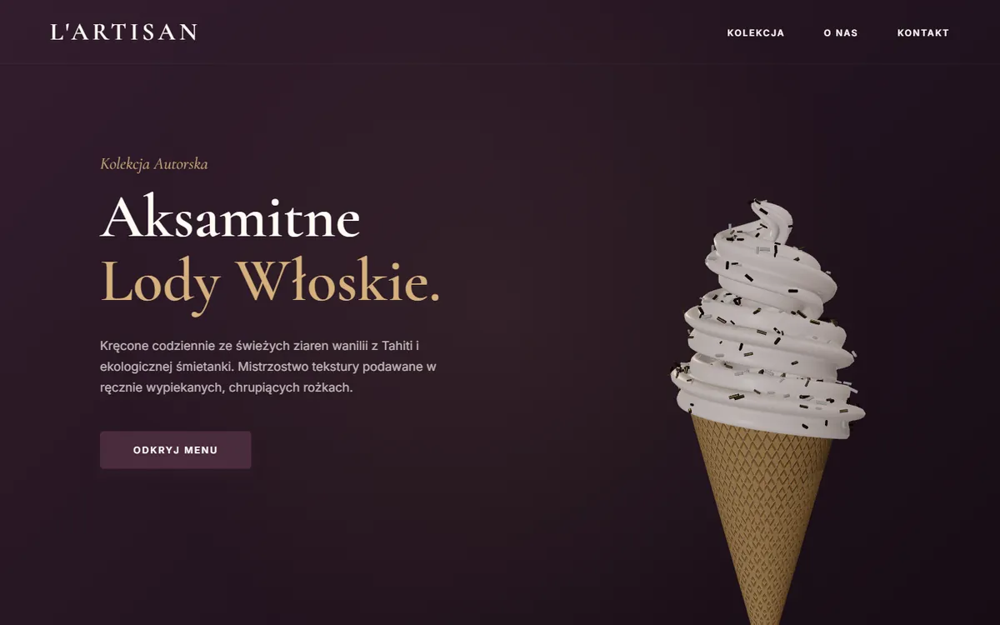
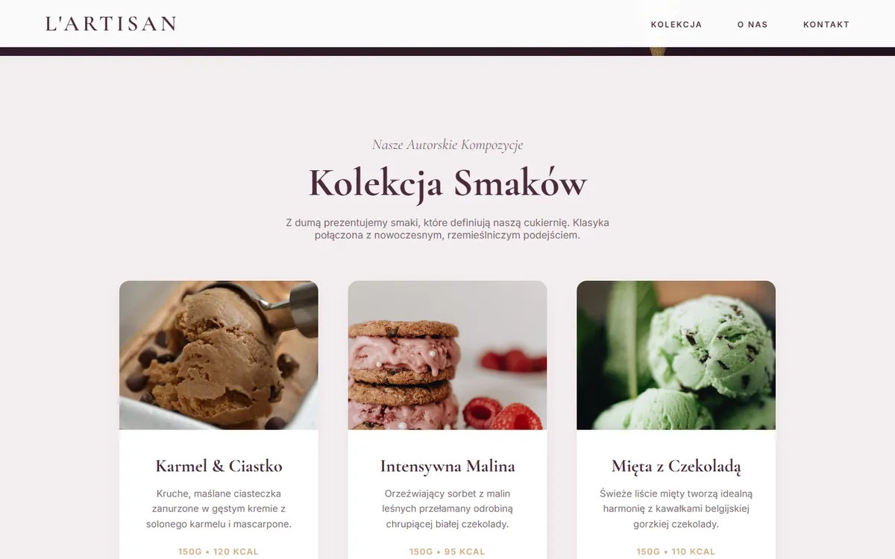
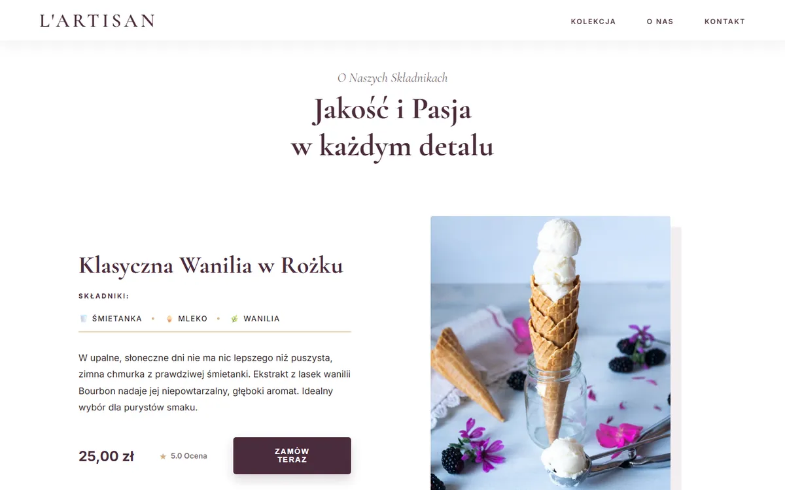
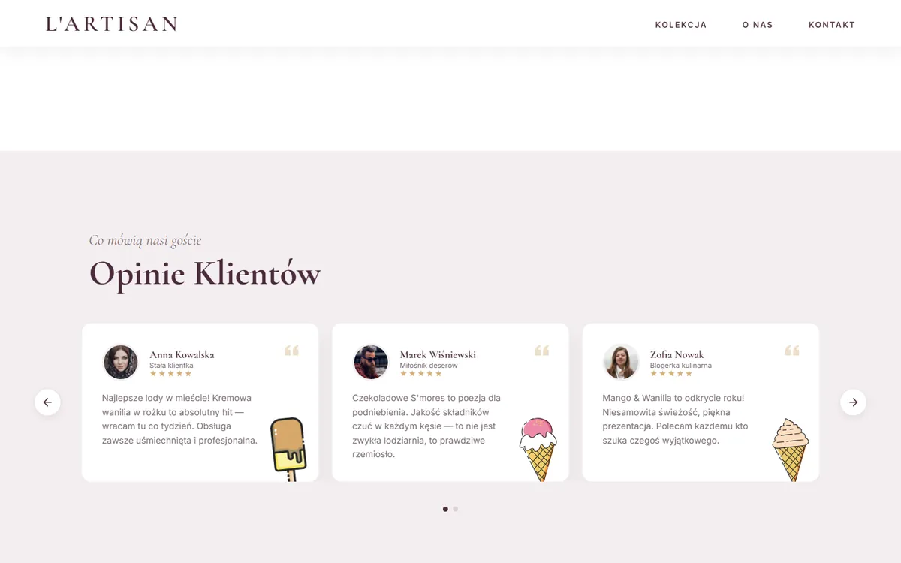
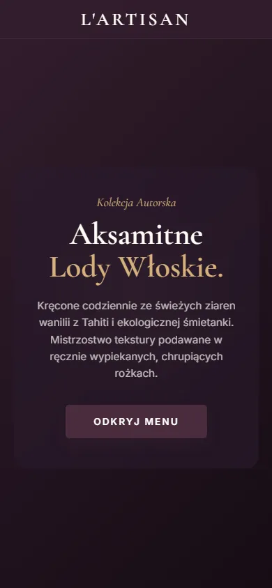
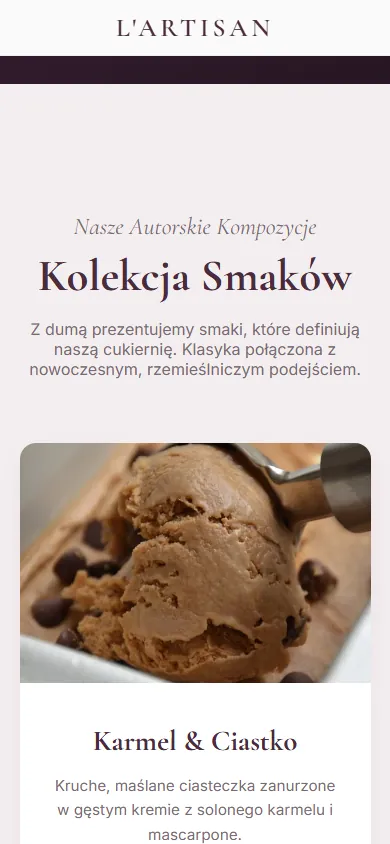
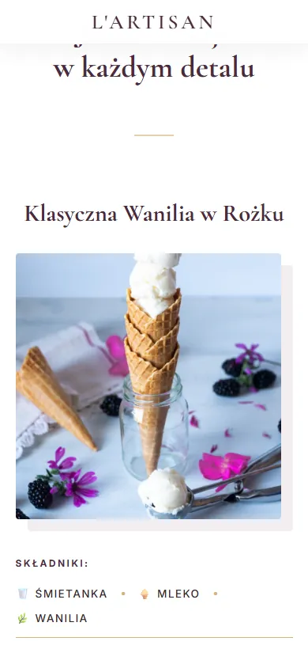

# L'Artisan

**Strona lodziarni rzemieślniczej z kolekcją smaków, wyróżnionymi deserami i animowanym rożkiem 3D.**

**Strona: [lody-page.vercel.app](https://lody-page.vercel.app)**

Lodziarnia jest fikcyjna — adres i numer telefonu są danymi demonstracyjnymi.



## Po co to jest

Strona prowadzi od prezentacji lodów do kolekcji smaków, opinii i danych lokalu.
Zdjęcia oraz opisy pokazują różnice między produktami, a animacja otwarcia nawiązuje
do nakładania lodów do waflowego rożka.

- **Kolekcja smaków:** karty ze zdjęciami, składem opisowym, gramaturą i kalorycznością.
- **Wyróżnione desery:** większe zdjęcia, rozszerzone opisy, ceny i statyczne oceny.
- **Opinie:** karuzela z przyciskami poprzedniej i następnej strony oraz wskaźnikami.
- **Kontakt:** godziny otwarcia, adres, telefon i interaktywna mapa.

| **Kolekcja smaków** | **Wyróżnione desery** |
|---|---|
|  |  |
| **Opinie o lodziarni** | |
|  | |

### Na telefonie

Karuzela dopasowuje liczbę widocznych opinii do szerokości ekranu. Na małym ekranie
scena 3D znika po animacji otwarcia, a jej renderowanie zostaje wstrzymane.

| **Start** | **Kolekcja** | **Wyróżnione** |
|---|---|---|
|  |  |  |

## Co jest w środku

**Front:** Vite, JavaScript i własny CSS. Treść strony jest w `index.html`,
a interakcje i scena 3D w `src/main.js`.

**Lody w Three.js:** rożek powstaje z geometrii stożka, tekstura wafla jest rysowana
na canvasie, a spirala lodów biegnie po krzywej Catmulla–Roma. Scenę uzupełniają
posypka, dysza maszyny, światła i cienie.

**Sekwencja otwarcia:** GSAP stopniowo odsłania geometrię lodów, przesuwa dyszę,
animuje posypkę i przechodzi do treści strony. ScrollTrigger odsłania kolejne sekcje
wewnątrz przewijanego kontenera `#main-site`.

**Mapa:** Leaflet, wczytywany w HTML z CDN, pokazuje kafelki Google Maps i własny
znacznik adresu. Przybliżanie kółkiem jest początkowo wyłączone.

**Zakres:** prezentacja oferty i kontaktu. Karty smaków są częścią strony;
nie otwierają osobnego okna szczegółów. Ceny, oceny i opinie są zapisane w HTML.

## Uruchomienie

```bash
npm install
npm run dev        # serwer deweloperski Vite
npm run build      # build do dist/
npm run preview    # podgląd builda
```

## Struktura

```text
index.html       treść, karty smaków, opinie i kontakt
src/
  main.js        scena 3D, GSAP, karuzela i mapa
  style.css      wygląd strony i układy responsywne
public/          ikony SVG
docs/zrzuty/     zrzuty na komputerze i telefonie
```

Licencja: MIT

---

Projekt i wykonanie: **Mikołaj Sitek** · [sitekmikolaj.pl](https://sitekmikolaj.pl) · [sitekmikolaj01@gmail.com](mailto:sitekmikolaj01@gmail.com)
